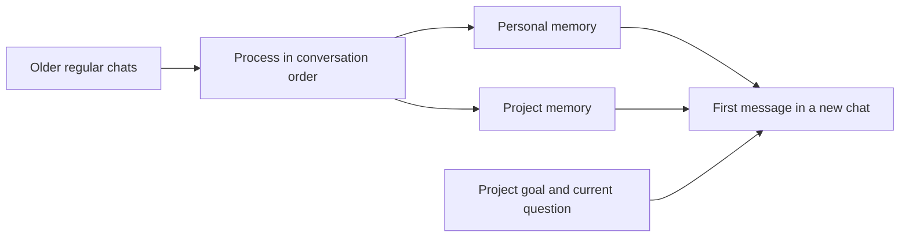

<div align="center">

# DeepSeek Pilot

**New chat. Keep going.**

Projects, personal and project memory, and conversation continuity for DeepSeek on the web.

[简体中文](README.md) · English

  


[Installation](#installation) · [Examples](#examples) · [Future goals](#future-goals)

</div>

DeepSeek Pilot is a third-party browser extension that enhances the DeepSeek website. Organize related chats into projects, maintain personal preferences and project decisions as editable memories, and bring that context into your next conversation.

> **0.9.0 is an early development version**, installed through developer mode. This independent project is not affiliated with DeepSeek. The image above is a concept diagram, not a product screenshot.

## Why Pilot

| Everyday friction | What Pilot provides |
| --- | --- |
| A project is scattered across chats | A project tree, manual assignment, pins, archives and new chats within projects |
| Every new chat needs the same background | Separate personal and project memories included in the first message |
| A conversation becomes too long | Continuation based on a configurable context budget |
| You want to inspect what is remembered | Categorized memory editing, pinning, import, export and deletion |
| Background tasks fail | A serial queue with pause, failure notices, retries and draft preservation |

## Examples

These fictional scenarios illustrate workflows, not real account records or guaranteed model outputs.

### 01 · One project, several conversations

```text
Project: Launch a personal portfolio
├── 01 Audience and positioning → Focus on design roles
├── 02 Content and structure    → Keep three core case studies
└── 03 Pre-launch review        → Continue in a new conversation
```

Move related chats into a project. Once older chats have been processed into memory, start a new chat in that project with project memory enabled to include saved goals and decisions in its first message.

### 02 · New topic, familiar working preferences

```text
Personal memory: Respond in Chinese; lead with the conclusion.
Project memory: Static pages for v1; finish three case studies this week.
Current question: Help me make a pre-launch checklist.
```

Personal memory stores lasting preferences; project memory tracks goals, constraints and progress. Separate scopes help keep temporary requirements distinct from lasting personal preferences.

### 03 · A longer conversation, continued work

```text
Current chat → Configured budget reached → Continuation task → New chat
```

The task queue handles continuation. The first message in the new chat includes applicable memories again. This is not unlimited context or a promise to preserve history verbatim. Inheritance previews and links between old and new chats remain planned work.

## Installation

### Option 1: Download ZIP (recommended)

Open the [repository](https://github.com/5J-5J/DeepSeek-Flow), choose **Code → Download ZIP**, and extract it to a permanent folder. Installation currently uses unpacked source; no build is needed.

### Option 2: Clone with Git

```sh
git clone https://github.com/5J-5J/DeepSeek-Flow.git deepseek-pilot
cd deepseek-pilot
```

The project is named DeepSeek Pilot; its repository URL still uses DeepSeek-Flow.

### Load in Chrome

1. Confirm that the extracted or cloned folder contains `core/manifest.json`.
2. Open `chrome://extensions/` in Chrome and enable **Developer mode**.
3. Choose **Load unpacked** and select the repository's **`core/`** folder.
4. Open or refresh [DeepSeek](https://chat.deepseek.com/) and sign in with your own account.
5. Create a project, describe its goal and move related chats into it. Inspect or maintain memories in the memory manager.
6. Start a new chat inside the project and check the project-memory switch before sending its first message.

No build step or separate model API key is required. Memory processing and other automation use auxiliary DeepSeek web conversations, require a working account and network, and generate site requests. The extension UI is currently in Chinese.

### Update an existing installation

For a Git installation, run `git pull --ff-only` in the repository. For ZIP installations, extract the updated source into the original location. Then reload **DeepSeek Pilot** in `chrome://extensions/` and refresh the DeepSeek page. Keep the loaded folder in place. Export important memories before updating; uninstalling the extension is not necessary.

If Chrome cannot find the manifest, select the `core/` folder containing `manifest.json`, not the ZIP file or repository root.

## How memory works



- After a new chat starts, eligible older regular chats are processed in order, subject to the configured start time and synchronization requirements. The newest regular chat and automation chats are excluded from ordinary memory learning.
- Active personal memory is included in the first message of regular chats. Project goals and memory also require a selected project and enabled project memory.
- Later messages do not repeat the injection. Enabling project memory mid-conversation does not add it retroactively.
- **Display switches affect visibility, not whether data is sent or learned.** Per-chat injection and learning controls are planned.
- Model-generated memories can omit or misinterpret information. Review important entries; manually pinned entries receive protection.

## About this project

DeepSeek Pilot aims to connect isolated questions into a personal workspace where work can continue: projects have goals, conversations have context, important decisions accumulate, and a new chat can pick up where you left off.

The current version provides the foundations: project organization, personal and project memory, and conversation continuation. Automatic classification is temporarily disabled; assign chats manually.

## Future goals

These are product directions, not shipped features. Goals and exploratory ideas will be prioritized based on feedback, without fixed release dates.

| Direction | Features we want to add | Value |
| --- | --- | --- |
| Project knowledge | Attach reference material, notes and reusable context; select relevant content for a question | Avoid repeatedly pasting project background |
| Traceable memory | Sources, change history, conflict review, confirmation and rollback | Understand changes and correct misunderstandings |
| Per-chat memory controls | Temporary chats and separate controls for injection and learning | Keep one-off questions out of lasting context |
| Smoother continuation | Preview summaries and inherited context; link old and new chats | Know what carries over into the next conversation |
| Project overview | Summarize goals, decisions, progress and next steps for manual confirmation | Resume a project with less effort |
| Search and organization | Cross-chat search, memory search, bulk moves and controllable automatic classification | Find information as the workspace grows |
| Reusable workflows | Project templates, saved prompts and context presets | Start recurring writing, learning and development work faster |
| Easier adoption | Versioned install archives, onboarding, English UI and exploration of browser-store distribution | Simplify installation and updates |

Project knowledge, overviews and templates are exploratory directions. They do not imply current support for file retrieval, task execution or multiple AI platforms.

## Data and boundaries

- Projects, memories and synchronized chat data are stored locally and separated by account. **Local storage does not mean offline operation.** Injected memories are sent to DeepSeek with messages; processing and compression also send relevant content.
- Permissions are `storage`, `tabs` and `alarms`, for storage, auxiliary tabs and scheduling. Host access is restricted to `https://chat.deepseek.com/*`.
- The extension keeps the latest 10 generated auxiliary chats and deletes eligible older ones from DeepSeek. Manually collected chats, unknown-origin chats and chats linked to running tasks receive protection.
- Deleting a project removes its local assignments, not remote chats. Chat-menu deletion does delete the corresponding chat.
- Each account retains five local memory snapshots. Clearing extension data also clears snapshots; export important memories beforehand.
- Compatibility depends on DeepSeek's web interface and behavior. Rate limits, expired sessions or account restrictions pause relevant requests; these protections do not guarantee an account will never be restricted.

## Development and contributions

The extension uses plain JavaScript, Chrome Manifest V3 and IndexedDB, with no build step. Offline checks require modern Node.js; browser interaction checks also require local Chrome.

```sh
node tests/classification-disabled-test.mjs
node tests/session-memory-test.mjs
node tests/automation-cleanup-test.mjs
node tests/request-body-test.mjs
node tests/memory-display-test.mjs
```

See [CONTRIBUTING.md](CONTRIBUTING.md) for contribution steps and test boundaries.

```text
core/background/   Memory processing and task queue
core/content/      Project tree and page integration
core/logic/        Storage, history and message handling
core/manage/       Memory manager
core/options/      Settings
tests/             Offline and local-browser checks
assets/            README artwork
```

## Open-source preparation and credits

No open-source license has been selected yet. The maintainer must decide before release; this project does not currently claim MIT or another open-source license.

Documentation presentation draws inspiration from [Mem0](https://github.com/mem0ai/mem0) and [Nanobrowser](https://github.com/nanobrowser/nanobrowser).
