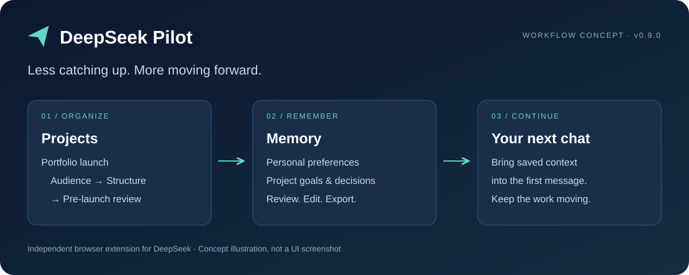
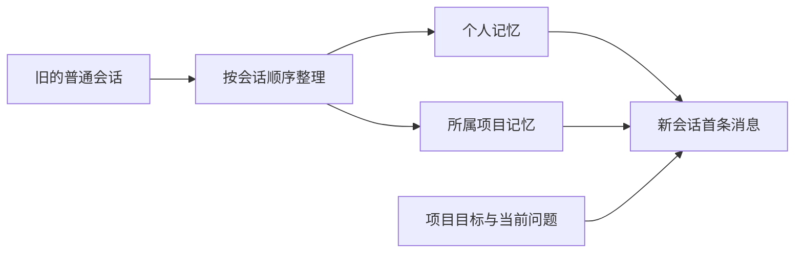

<div align="center">

# DeepSeek Pilot

**少翻聊天记录，多推进一点。**

从项目与记忆出发，探索用一个工作聊天框，看进度、理思路、接着做。

简体中文 · [English](README.en.md)

  



[安装方式](#安装方式) · [场景展示](#场景展示) · [未来开发目标](#未来开发目标)

</div>

DeepSeek Pilot 是一个第三方浏览器扩展，直接增强你熟悉的 DeepSeek 网页。把相关对话放进项目，把个人偏好和项目决定保存在可管理的记忆中，让下一次对话有背景可循。

> 当前为 **0.9.0 早期开发版**，通过开发者模式加载。独立开发，与 DeepSeek 官方无隶属关系。统一工作聊天框是未来方向，当前仍通过项目与会话操作。上图为现有基础能力的概念示意，并非产品截图。

## 为什么用 Pilot

| 日常遇到的问题 | Pilot 提供的能力 |
| --- | --- |
| 一个项目散落在多个聊天里 | 项目树、手动归属、置顶、归档和项目内新建会话 |
| 每次开新对话都要重复背景 | 分开管理个人与项目记忆，在新会话首条消息中带入 |
| 对话越来越长，想换窗口继续 | 按配置的上下文预算触发长会话接续 |
| 不知道模型记住了什么 | 按类别查看、编辑、固定、导入、导出及删除记忆 |
| 后台整理失败后难以处理 | 串行任务队列、暂停、失败提醒、重试和草稿保留 |

## 场景展示

以下为虚构示例，不是真实账号记录或模型输出承诺。

### 01 · 一个项目，多次推进

```text
项目：个人作品集上线
├── 01 定位与受众       → 确认面向设计岗位
├── 02 内容与结构       → 确认保留三个核心案例
└── 03 上线前检查       → 在新对话中继续推进
```

将相关会话手动移入项目。旧会话整理完成后，在项目内新建会话并开启项目记忆，首条消息可带入已保存的目标与决定。

### 02 · 换话题，保留协作习惯

```text
个人记忆：用中文回答；先给结论，再解释依据。
项目记忆：首版只做静态页面；本周先完成三个案例。
当前问题：帮我列出上线前的检查清单。
```

个人记忆保存长期偏好，项目记忆保存当前工作的目标、约束和进度。两者分开管理，不把临时项目要求混成长期个人偏好。

### 03 · 对话变长，继续推进

```text
当前对话 → 达到配置预算 → 接续任务 → 新会话继续
```

接续由任务队列处理，新会话首条消息重新带入适用记忆。接续不是无限上下文，也不承诺逐字保留全部历史；继承内容预览和新旧会话跳转仍在路线图中。

## 安装方式

### 方式一：下载 ZIP（推荐）

在[仓库主页](https://github.com/5J-5J/DeepSeek-Flow)点击 **Code → Download ZIP**，下载后解压到一个固定目录。目前通过源码加载安装，不需要编译。

### 方式二：Git 克隆

```sh
git clone https://github.com/5J-5J/DeepSeek-Flow.git deepseek-pilot
cd deepseek-pilot
```

项目展示名称为 DeepSeek Pilot，当前仓库地址仍为 DeepSeek-Flow。

### 在 Chrome 中加载

1. 确认解压或克隆后的目录中存在 `core/manifest.json`。
2. 在 Chrome 中打开 `chrome://extensions/`，开启**开发者模式**。
3. 点击**加载已解压的扩展程序**，选择仓库中的 **`core/`** 文件夹。
4. 打开或刷新 [DeepSeek 网页版](https://chat.deepseek.com/)，使用自己的账号登录。
5. 创建项目并填写目标，将相关会话移入项目；在记忆管理页查看或维护记忆。
6. 在项目内开启新会话，发送首条消息前确认项目记忆开关。

运行扩展无需构建或配置单独的模型 API key。记忆整理等自动化通过 DeepSeek 网页辅助会话执行，需要可用账号与网络，并会产生站点请求。目前扩展界面为中文。

### 更新已安装的扩展

Git 安装在仓库目录执行 `git pull --ff-only`；ZIP 安装将新源码解压到原安装位置。然后在 `chrome://extensions/` 找到 **DeepSeek Pilot**，点击重新加载，再刷新 DeepSeek 页面。不要删除已加载的目录；更新前可先导出重要记忆，不必卸载扩展。

如果提示找不到 manifest，请确认选择的是包含 `manifest.json` 的 `core/`，而不是 ZIP 文件或仓库根目录。

## 记忆如何工作



- 开启新会话后，符合起始时间与同步条件的旧普通会话按顺序处理；最新普通会话和自动化会话不参与普通记忆学习。
- 生效个人记忆在普通会话首条消息带入；项目目标与记忆还要求已选项目且开启项目记忆。
- 后续消息不重复注入，中途打开项目记忆也不会补发。
- **显示开关只影响页面展示，不代表停止发送或停止学习。** 按会话控制是否带入、是否学习仍待开发。
- 模型整理可能遗漏或误解，请检查重要记忆。人工固定条目受到保护。

## 关于本项目

做几个项目，往往就会留下几十个聊天。真正费时间的，是回来以后重新弄清楚：上次决定了什么、现在卡在哪里、下一步该做什么。

DeepSeek Pilot 希望逐步把这些线索汇到一个工作聊天框。你可以问「几个项目最近怎么样？」「今天先推进哪件事？」，查看基于已有记录整理的进度与建议，再选择一个项目继续聊。项目列表和原始会话仍可查看，让每个总结有据可查。

目前已经实现项目管理、个人与项目记忆和长会话接续，正在为这个方向打基础。**统一入口、跨项目进度展示和下一步推荐尚未实现。** 自动会话归类也暂时关闭，请手动移动会话。

## 未来开发目标

希望逐步做到的体验（以下为设想，不是当前功能演示）：

> **你：** 今天只有半小时，先推进哪个项目？
>
> **Pilot：** 根据你已记录的进度，作品集还差案例介绍；阅读计划在等你选论文。可以先完善一个案例的介绍，要继续作品集吗？
>
> **你：** 好，接着上次的结构写。
>
> **Pilot：** 展示作品集最近确认的结构与下一步，供你核对后继续。

建议只基于可读取的项目记录和你提供的时间、优先级等信息；缺少进展时应提示补充，不把推测写成已完成的事实。由你选择推进什么，Pilot 帮你减少找背景的时间。

| 路线 | 计划加入的能力 | 达成后你可以做什么 |
| --- | --- | --- |
| 1 · 看清一个项目 | 项目进度摘要、最近决定、阻塞与下一步，附来源和更新时间 | 少翻历史，知道项目停在哪；修正过时信息 |
| 2 · 在一处看多个项目 | 统一工作聊天入口，以简短卡片或摘要展示各项目进度 | 在同一个聊天框问「最近几个项目怎么样？」 |
| 3 · 商量下一步 | 结合目标、阻塞、已记录优先级与可用时间给出建议，说明依据 | 问「今天先做什么？」，自行选择或调整建议 |
| 4 · 选定项目继续聊 | 识别明确的项目选择，展示将使用的背景；有歧义时先确认 | 从总览进入具体工作，减少手动寻找相关会话 |
| 5 · 把新进展带回来 | 从后续讨论中提出进度更新，经确认后回写，保留来源和修改记录 | 让工作聊天与项目总览逐步形成闭环 |

这是一条分步验证的产品路线，不设固定上线日期。现有记忆的准确性、会话间的项目隔离和长对话接续会持续完善；资料管理、模板与更多分发方式放在主线之外，按需要再扩展。目标是让一个入口更好用，不要求把所有历史塞进同一条无限长的对话，也不承诺自动替你完成项目。

## 数据与边界

- 项目、记忆和同步会话数据保存在扩展本地存储，按账号区分。**本地保存不等于离线运行**：带入的记忆随消息发给 DeepSeek，整理与压缩也会发送相关资料。
- 权限为 `storage`、`tabs`、`alarms`，用于存储、辅助标签页和任务调度；站点权限限于 `https://chat.deepseek.com/*`。
- 插件生成的辅助会话保留最近 10 条，符合条件的更早辅助会话会从 DeepSeek 删除。手动收纳、来源不明及运行任务关联会话受到保护。
- 删除项目只解除插件归属，不删除远端聊天；会话菜单的删除操作则会删除对应聊天。
- 每个账号保留最近五份本地记忆快照；清除扩展数据也会清除快照，请提前导出重要记忆。
- 依赖 DeepSeek 网页结构与行为，站点更新可能影响兼容性。限流、登录失效或账号受限会暂停相关请求；这些保护不保证账号不会受限。

## 开发与贡献

使用原生 JavaScript、Chrome Manifest V3 和 IndexedDB，无构建步骤。离线检查需现代 Node.js 环境；浏览器交互检查另需本机 Chrome。

```sh
node tests/classification-disabled-test.mjs
node tests/session-memory-test.mjs
node tests/automation-cleanup-test.mjs
node tests/request-body-test.mjs
node tests/memory-display-test.mjs
```

贡献流程与验证说明见 [CONTRIBUTING.md](CONTRIBUTING.md)。

```text
core/background/   记忆整理与任务队列
core/content/      项目树与网页交互
core/logic/        存储、历史与消息处理
core/manage/       记忆管理
core/options/      设置
tests/             离线与本地浏览器检查
assets/            README 展示素材
```

## 开源准备与致谢

当前仓库尚未设置开源许可证，发布前需由维护者确认；在此之前不宣称采用 MIT 或其他开源授权。

文档组织参考 [Mem0](https://github.com/mem0ai/mem0) 的记忆价值表达与 [Nanobrowser](https://github.com/nanobrowser/nanobrowser) 的演示和安装结构。
