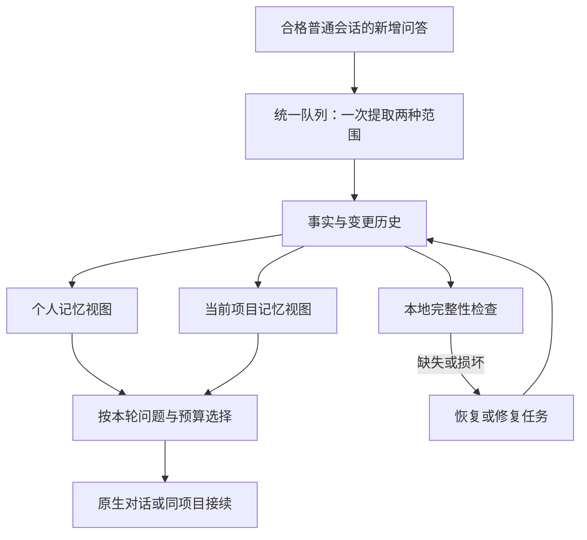

> 历史方案：本次已按用户确认改为旧会话顺序更新，删除原话证据与轮数阈值，个人和项目独立返回完整记忆列表。当前实现以 README 和本地存储数据表设计为准；下文保留原方案记录。

# DeepSeek 项目工作台：记忆模块定制化修改方案

日期：2026-10-11。状态：完整方案仍为设计提案；2026-10-12 先实施下述两项简化改动。

当前实施范围仅为「少量历史快照＋删除意图记录」与「自动检查＋局部恢复」：每个账号最多 5 份本地快照，删除同时保存意图并清除快照正文；自动从快照补回缺失或损坏的条目，核对来源和项目，不重发历史会话。新增一张 memoryHistory 表，保留现有 memories、队列、处理记录和预算规则。下文的三层记忆、事件历史、相关性选择及模型修复任务尚未实施，不作为本次必需项。实现细节和恢复边界见 [本地存储数据表设计](本地存储数据表设计.md)。

依据：项目开发 Spec、当前 0.9.0 活跃实现，以及本次讨论。目标是让插件自动维护个人与项目记忆，用户正常使用时无需整理、重试和修复记忆，同时保留查看、纠正、批量删除及导入导出的接口。

## 1. 从插件初衷出发

这个插件首先是 DeepSeek 的项目工作台：把同一个项目的多段会话连接起来，让后续对话知道用户的稳定偏好、项目约束、已确认决定、当前进展和下一步；长会话接续后仍能继续工作。用户应专注于原生对话，插件在后台完成必要的观察、整理和维护。

据此，本方案保留以下体验：

- 保留 DeepSeek 原生回答区、新建会话、搜索、重命名、编辑、重新生成和删除。
- 个人记忆跨项目使用；项目事实只在相应项目使用；自动化会话不成为记忆来源。
- “项目记忆”按钮继续控制本轮发送是否带入记忆。关闭注入时仍可整理合格的普通会话，不把这个按钮改成整个记忆系统的总开关。
- 同一项目的待整理消息只发送一次，同时处理个人与项目范围；未归项目只处理个人范围。
- 记忆起始时间沿用当前语义：只学习在该时间及之后创建的普通会话，默认插件首次运行时间。恢复也遵守该范围，不借修复之名扩大历史采集。
- 手动项目归属、人工修改的记忆优先；新项目建议仍沿用现有确认流程。
- 所有发起 DeepSeek 自动化会话的任务继续进入统一队列，保留暂停、取消、调整顺序和查看执行会话的能力。

推荐目标：**后台 agent 自动决定记什么、更新什么、何时维护；本地程序保证来源、范围、版本和恢复的一致性。**

本文件保留完整提案作为讨论参考；当前能力以顶部实施范围、活跃代码及数据表说明为准，不把 README 中仍混杂的旧文件夹架构当作当前能力。

## 2. 借鉴已有项目，按浏览器插件的条件取舍

| 参考项目 | 已有机制 | 本插件采用的部分 |
|---|---|---|
| Letta | Dreaming 在后台回顾近期会话、整合经验；MemFS 为记忆保存版本历史 | 后台维护、修改可追溯、恢复优先使用已保存版本；用 IndexedDB 实现，不要求用户安装 Git 或运行 Letta 服务。[Dreaming](https://docs.letta.com/configuration/memory)、[MemFS](https://docs.letta.com/concepts/memfs) |
| LangMem | 后台提取和整合记忆，支持延迟处理，减少频繁整理 | 新消息合批、活动结束后补处理、用户与项目范围隔离。[后台指南](https://langchain-ai.github.io/langmem/background_quickstart/) |
| Mem0 | 结合新消息与相关已有记忆进行结构化提取；不同产品和版本的写入策略有所区别 | 增量提取、已有事实辅助消歧、管理与检索接口。实现时以选定版本代码为准。[官方源码](https://github.com/mem0ai/mem0/blob/main/mem0/memory/main.py) |
| Zep / Graphiti | 事实关联来源，会记录事实的有效与失效时间 | 来源证据、事实变化与历史保留。先用本地字段和索引表达，避免引入图数据库。[Context Graph](https://help.getzep.com/v3/graph-overview) |

下文的自动恢复、忘记规则和迁移流程是针对本插件的设计建议，不是上述项目共同提供的一键能力。首版沿用现有 DeepSeek 调用路径，不新增模型供应商、向量服务或常驻服务器。

## 3. 当前实现已经具备什么，还缺什么

活跃入口是 `core/background/workbench.js` 和 `core/background/incremental-memory.js`，数据层为 `core/logic/db.js`；旧 `background.js`、旧文件夹管线不作为本轮重构入口。

| 当前机制 | 处理方式 |
|---|---|
| 统一增量队列、同项目合并请求 | 保留，新增维护与修复任务复用调度 |
| 消息内容指纹、按个人／项目范围去重 | 保留，将含义明确为“这个消息版本在该范围已成功提取” |
| 原子提交记忆、处理记录、队列及任务状态 | 保留，并将变更历史和修复依据纳入同一事务 |
| 来源、分支、项目归属、人工固定和范围版本校验 | 保留，补上多来源和人工修改保护 |
| 保存失败可复用有效模型结果 | 保留，普通故障支持自动恢复 |
| 记忆删除后，消息仍为已处理 | 保留正常去重；增加独立的恢复路径，不清空全局处理记录 |
| 成功后清空 `cachedResult`，只保留结果计数 | 增加持久化变更记录，保存已提交事实及其变化依据 |
| 个人预算限制全部 ACTIVE 记忆，超额旧项停用，新批次可能失败 | 预算改为约束本次注入内容；有效事实可以继续保存 |
| `prepareSend` 取前 45 条并截到 12000 字符 | 改为按相关性、类别和优先级选择完整条目，不在事实中间截断 |
| 失败批次通常要求手动重试 | 根据失败类型自动恢复，结果不明时先核对，避免重复发送 |
| 类别编辑不一定保护既有自动条目的人工改动 | 所有内容上的人工修改都记录为保护约束，避免下次自动覆盖 |

当前去重与事务机制值得保留。真正需要改变的是：事实保存、上下文选择、处理进度和恢复依据各自负责清楚的事情。

## 4. 三层记忆，复用现有数据

### 4.1 会话来源层

继续使用 `sessions`、`messages`、`memberships` 和当前分支解析。输入采用用户原文与助手正文，不把注入记忆、THINK 或自动化会话当作新证据。

不全量扫描所有远端历史。新消息完成时观察、启动时核对已登记且符合起始范围的会话、修复时按来源 ID 获取必要记录。每次处理前校验账号及来源当前版本。

### 4.2 事实层

复用 `memories`，将它作为可持续保存的事实库。用户仍看到熟悉的类别：

- 个人：资料、偏好、工作方式、术语、其他。
- 项目：目标、约束、决定、进展、阻塞、下一步、其他。

每条事实保留有效状态、来源、更新时间和人工保护信息。重复表达可增加证据，明确变化更新当前值；被替代的旧值退出注入但保留变更依据。

个人／项目是使用范围，不额外建立一组“语义／情节／程序”标签让用户管理。成功经验或失败教训以后可作为项目事实扩展，首版先确保偏好和项目状态可靠。

### 4.3 使用层

新增可重建的 `memoryViews`，保存分类后的候选内容、对应事实 ID、版本和校验摘要。首版采用本地确定性选取和格式化，不为每次摘要生成额外调用模型。

发送时选稳定的个人偏好、当前项目必要约束、近期相关决定及进展。个人部分继续采用 2000 UTF-8 字节的保守发送预算；项目部分服从当前上下文与回答预留量。存储中的有效事实不因本轮放不下而被停用。

记忆页面默认显示当前生效内容；“更多”里可以查看未带入本轮、候选、历史或来源失效的事实。长期存储与本次上下文不要求一一对应。

## 5. 后台 agent 怎么自动维护

### 5.1 调度：达到阈值及时整理，少量积压也能完成

保留默认每 5 轮的账号阈值与按项目合批。补上一次空闲触发：有完整待处理问答、账号近期无新回答且当前无整理任务时，默认等待约 2 分钟后处理不足阈值的积压。

新消息到达就重新计算空闲时间。连续聊天依赖轮数阈值合批，避免每个短暂停顿都新建辅助会话。不同项目在同一空闲窗口各自合批；后台维护只在事实发生变化或本地检测发现问题时触发，不固定周期调用模型。

Chrome MV3 后台可能被终止，任务进度、下次执行时间和租约必须持久化，用消息事件、`chrome.alarms` 和启动恢复推进，不能依赖内存定时器保持常驻。[Chrome 官方生命周期说明](https://developer.chrome.com/docs/extensions/develop/concepts/service-workers/lifecycle)

这里的自动运行以浏览器可运行且 DeepSeek 登录有效为前提。浏览器关闭时保存进度，下次启动再继续；账号不明或登录失效时不发起模型任务。无需为本方案安装常驻服务。

### 5.2 决策：新增、合并、更新、退出当前记忆

模型输入为本批新增问答、相关已有事实及人工保护／忘记约束。保持同项目一次请求，结构化输出分别描述个人和项目的变更。

| 情况 | 默认决策 |
|---|---|
| 用户明确表达可跨会话使用的稳定偏好 | 保存个人事实，必须引用用户原话 |
| “这次用中文”这类一次性要求 | 不升级为长期偏好 |
| 用户确认项目决定或已完成事项 | 更新项目事实及下一步；助手建议本身不证明完成 |
| 新消息重复支持旧事实 | 合并来源，不新增同义条目 |
| 明确改变偏好或项目约束 | 更新自动事实，记录旧值被替代 |
| 同时出现两条难以解释的冲突 | 保留最后已确认值，新信息暂存候选，不阻断其他更新 |
| 人工修改事实与新表达冲突 | 保护人工内容；只对该冲突项提供纠正入口 |
| 不存在值得保存的信息 | 记录“成功提取，结果为空”，不无限重试 |

不把模型自报的置信度当作事实证据。首版用明确原话、事实对象、时间以及已确认行为判断；不实现按时间自动删除稳定偏好的通用遗忘曲线。

### 5.3 执行：结构化操作，受程序约束

在现有固定 JSON 协议上增加操作语义：`ADD`、`MERGE`、`UPDATE`、`RETIRE`、`NOOP`。`RETIRE` 表示旧事实退出当前上下文，不等于物理删除来源或历史。

每个操作要包含范围、类别、本批来源，以及更新／合并目标 ID。目标限定在本次提供的同范围事实中；合并不跨项目、不把人工事实覆盖成自动事实。模型可以判断如何更新，实际写入仍由本地校验器完成。

不让模型任意执行浏览器操作或删除 DeepSeek 会话。采集、查询事实和提交合法变更是首版记忆 agent 的能力边界；结构化变更已足够完成主流程，无需先建立通用工具运行框架。

### 5.4 自动重试：先判断能否安全重试

| 失败类型 | 自动处理 |
|---|---|
| 已收到有效结果，本地保存失败 | 复用结果重试事务，优先级高于重新请求模型 |
| 网络临时失败、服务端限流且确认尚未提交 | 退避重试，建议 30 秒、2 分钟、10 分钟，遵守服务端等待信息 |
| 来源／人工版本改变 | 放弃旧结果，只为受影响范围重新规划 |
| JSON 格式或目标引用无效 | 在本批材料内最多一次纠正；仍无效则隔离该任务，继续其他任务 |
| 登录失效 | 等待账号恢复，停止制造新的辅助会话 |
| 请求可能已发送，但标签页关闭或结果不明 | 先查原执行会话；核对到结果就接收，无法核对则显示待处理，不直接再发 |

最多自动重试三次后进入“需要处理”，保留原因和来源。重试的模型调用、纠正和后台压缩共用次数限制，避免故障产生大量辅助会话。此重试规则不扩展到用户提问或长会话接续的自动重发。

## 6. 自动恢复：把提取完成与视图完成分开

### 6.1 处理记录的含义

`memoryTurns` 继续按消息 ID、内容指纹、范围和项目去重。`DONE` 的含义变为：这个消息版本在该范围的提取结果已提交，并保存了恢复依据；`SKIPPED` 仍表达用户取消／跳过。

增加对应提交 ID、输出事实引用，以及显式空结果标记。视图另记事实版本和渲染规则版本。删除视图不清除消息处理记录；重建视图也不重新提取历史消息。

提取后提交结果为空是合法成功。不能用“有 DONE 消息，但没有同样数量的记忆”判断丢失，因为多轮会话可能产生一条事实，也可能不产生事实。

### 6.2 变更历史与检查点

新增 `memoryEvents`，记录每次已提交的事实变更及操作意图，包含模型更新、人工修改、导入、忘记、恢复和来源失效。必要字段包括提交 ID、幂等键、前后版本、变更前后记录、影响范围和提交校验摘要。

记忆、事件、处理记录、范围版本、队列和任务完成状态在同一个 IndexedDB 事务中提交。模型结果缓存仍用于事务失败后的恢复，不再成为唯一恢复依据。

检查点也写入 `memoryEvents`，不另建快照表。建议每 50 个成功提交生成一次已验证的全账号事实检查点，并保留足以重建当前状态的后续事件。历史可以压缩，但不能同时删除唯一检查点和重放所需的事件。保留有限的旧版本供撤销，初始建议 7 天；额度达到上限时先压缩历史，而不是删除当前事实。

### 6.3 检查与修复顺序

启动、成功提交后和失败恢复时，做轻量本地检查：范围版本、记录摘要、视图依赖、任务及事件是否一致。摘要缺失、记录损坏或已提交状态不一致才进入修复。

1. **视图缺失**：从有效事实重新生成，完全本地执行。
2. **事实缺失／损坏**：从可信检查点和事件恢复，再生成视图。重放历史不恢复当前已明确忘记、失效或超出学习范围的事实。
3. **检查点／事件损坏，但来源可验证**：只对受影响的来源版本创建修复任务，允许重新提取已处理消息。修复任务使用独立幂等键，正常增量记录仍保留。
4. **恢复依据和来源均不可用**：保留现存的已验证事实，显示明确限制，不靠模型猜测缺失内容。

单个条目缺失时，优先重放到该范围的临时恢复集合，再核对来源和忘记规则后写入。整范围重建先保存可用数据、建立独立构建版本，成功校验后切换；失败不清空正在使用的记忆。修复过程中新增消息留在队列，切换后继续增量处理。

如果整个扩展数据都被清空，同库检查点也会丢失。第二阶段提供用户一次授权的独立文件备份：授权后自动写入账号隔离的事实、历史检查点、忘记规则和必要恢复元数据；文件是备份，不引入双主同步。授权失效时显示备份暂停。导入旧备份必须与现存的更新意图合并，不能覆盖较新的忘记记录。

备份包明确包含格式版本、账号 ID、项目映射、事实及人工保护属性、已验证检查点和后续事件、忘记规则、范围版本、`memoryTurns` 去重记录及来源身份／指纹。会话正文不默认复制到备份包。恢复时核对当前登录账号；使用旧备份从全新环境恢复，只能恢复到备份时刻，无法凭空保留备份之后已丢失的删除意图或新事实。

## 7. 忘记、误删和来源失效必须分开

### 7.1 用户明确删除

保留现有“批量删除”和类别编辑清空条目的操作。删除动作落成 `FORGET` 事件，并移除生效事实，保存最小的排除信息：范围、原事实身份、可用的稳定事实键及已知来源版本。

同一来源重放或修复时直接排除；新消息的同义信息也先与忘记规则匹配。仅靠文本哈希无法阻止所有改写，因此同义判断需要本地规则及模型受约束判断共同完成，并明确测试。

首次版本提供短期“撤销删除”，默认 7 天后清理用于撤销的内容副本；期间显示可撤销状态。真正需要立即清除恢复副本时，提供“彻底删除恢复副本”。清理同时覆盖相关历史事件、检查点和已授权备份中的内容副本，留下最小排除信息，避免修复复活。恢复功能不读取这类已清除副本。

忘记规则可由用户撤销或明确重新允许记住该事实；普通的新会话不自动取消用户的忘记意图。规则是针对事实的排除约束，不等于绝对精确的自然语言识别承诺。

### 7.2 人工编辑与导入

类别保存仍一次完成。实际修改或新写的内容设为人工保护并记录版本，未修改条目保持原属性；类别里清空旧条目按删除处理。模型可提出冲突候选，不直接覆盖人工事实。

用户直接编辑使用层内容时，变化必须落到事实层，避免下次视图刷新丢掉修改。导入为带来源标记的人工／外部事实，不假装它来自已验证的 DeepSeek 消息；保留原导入映射流程。

### 7.3 会话删除、分支改变或项目移动

- 分支切换或编辑：撤销旧来源的支持；如果事实仍有其他当前有效来源则保留，否则置为 STALE。新分支按新指纹处理。
- 会话移动：旧项目范围撤销该来源，新项目仅补做项目范围；个人事实不重复提取。
- 服务端明确删除会话：移除待处理来源，停止基于它的新提取和远端修复；只由该会话支持的自动事实退出生效状态。有其他有效来源的事实和人工事实可以保留。
- 删除会话与“忘记某个事实”是两种操作；删除会话不会删除整个项目，已删除来源也不会被恢复任务重新登记。
- 时间范围收紧：自动事实按仍合格的来源重新判断，人工事实保留。未知历史会话创建时间继续暂不学习，核对到时间后再判断。

自动恢复必须服从当前的分支、归属、账号、学习范围和删除意图；旧快照不能绕过这些约束。

## 8. 按本轮任务选记忆，让预算发挥作用

第一阶段使用本地筛选和排序，不新增 embedding 请求：

1. 固定提供当前项目目标、必要约束和人工保护的关键内容。
2. 提供与本轮输入、近期会话相关的个人工作方式、术语和项目决定。
3. 提供最新已确认进展、未解决阻塞和下一步，减少已经完成的行动项。
4. 其余有效事实保留在库中，根据后续问题再选用。

每条按完整事实选取，避免按字符串硬截断。短事实可直接格式化进视图；确需压缩的范围进入低优先级维护任务，只读取相关事实，不重发会话正文。压缩结果必须引用事实 ID，不新增未经来源支持的信息。

个人 2000 字节上限只统计本轮个人部分及类别前缀。项目范围按已有上下文预算选取，实际 token 缺失时沿用保守估算，不显示伪造计数。若人工关键内容本身超过预算，保留原文，选择能完整容纳的关键项并显示一次提示，不静默截断或停用原事实。

原生“项目记忆”按钮、普通发送和后继会话使用同一个选择器。记忆是资料，用户本轮明确要求优先；不能把来源中的指令升级成系统规则。后继会话继续保留原始问题、近期必要问答及当前有效项目资料。

## 9. 最小数据与模块改动

拟将 IndexedDB schema 从 2 升至 3。复用所有现有表，只增加 `memoryEvents` 和 `memoryViews` 两张表。

| 数据位置 | 拟调整 |
|---|---|
| `memories` | 作为事实库；保留 ID、范围、类别和人工固定，增加来源引用列表、来源有效状态、可选事实键、变更原因和提交引用；先兼容 ACTIVE/CANDIDATE/DISABLED/STALE，替代关系用原因字段表示 |
| `memoryTurns` | 保留现有 turnKey；增加提交引用、结果事实引用、空结果标记和提取协议版本，不因为渲染规则升级自动重发所有历史 |
| `memoryEvents` | 主键 `[accountId, eventId]`；范围、顺序、幂等键、操作意图、变更前后值、校验摘要；支持提交记录、忘记规则和检查点，便于重放 |
| `memoryViews` | 主键 `[accountId, viewKey]`，viewKey 按范围／项目生成；保存事实依赖、分类文本、渲染规则版本、预算口径及校验摘要，不复制全部会话 |
| `jobs` | 保留 DISTILL；新增 `memoryOperation: EXTRACT / COMPACT / REPAIR`、触发原因、退避时间、来源范围、构建版本和恢复方式；本地修复不创建 DeepSeek 会话 |
| `settings` | 保留现有人工修改 epoch；增加已提交范围版本／事件头、迁移状态和空闲触发时间。epoch 用于拒绝旧结果，不冒充提取进度或历史日志 |

多来源引用至少包含会话、用户／助手消息、指纹、范围、项目和证据。语义合并需要模型判断；精确重复和来源去重由程序完成。当前视图为事实的派生缓存，不能成为唯一真相源。

| 文件 | 主要改动 |
|---|---|
| `core/background/incremental-memory.js` | 提取协议、两范围批次、独立修复、结果持久化与自动重试 |
| `core/background/workbench.js` | 调度、人工修改／忘记事件、来源失效、发送与接续选择器、状态摘要 |
| `core/logic/db.js` | 两个新 store，扩展原子提交、事件重放和迁移读写 |
| 新 `core/logic/memory-policy.js` | 事实选择、预算、来源有效性和忘记约束的可独立验证逻辑 |
| 新 `core/background/memory-maintenance.js` | 完整性检查、检查点、本地恢复、维护触发；先限定这些职责 |
| `core/manage/manage.js`、`manage.html` | 默认视图、类别纠正、删除撤销、来源与历史入口，兼容导入导出 |
| `core/options/options.js`、`options.html` | 自动维护状态、批次与重试明细、备份入口；减少默认展示的信息量 |
| `core/content/workbench.js` | 继续负责观察和展示，接收同步状态；不在内容脚本中另建记忆调度器 |

文件划分可随实现微调；不先拆成通用 agent 平台。所有事实变更路径，包括后台观察、人工编辑、导入和修复，都必须通过相同的事务与事件规则，避免出现未留恢复依据的旁路写入。

## 10. 用户界面：平时安静，必要时能解释

记忆页面保留左侧“个人／项目”、右侧分类内容的布局，不恢复每条记忆的编辑、停用、固定按钮，也不为每个类别添加“添加”按钮。类别纠正统一保存，来源和历史放入详情。

顶部只显示一个主要状态：已同步、等待整理、整理中、修复中、等待登录、需要处理。候选或冲突不阻断其他范围，只有用户打开管理页才显示具体项。普通成功更新不弹 toast。

设置页默认显示队列概要；展开后保留用户已经要求的会话数、轮数、个人／项目更新范围、重试次数和执行会话。新增触发原因及“本地恢复／重新提取”标记。

需要解释的规则通过 `i` 详情按钮悬停或键盘聚焦展示。按钮顺序统一为查看结果、解决必要问题、更多管理；危险操作放入“更多”。人工操作始终可用，但不成为正常自动维护的必经步骤。

## 11. 迁移与分阶段交付

### 阶段一：可靠事实与恢复，先解决当前痛点

1. 在 schema 升级事务中增加新表，保留旧数据；后续按账号迁移，账号未完成时不启动新协议作业。
2. 将现有 `memories` 视为初始事实，保留 ID、状态、范围和人工属性，生成基线检查点与视图。
3. 现有 `memoryTurns` 保留，不自动清空 DONE，也不因升级批量重发全部旧会话。
4. 旧 DONE 没有完整结果记录，标记为历史覆盖信息不足；不能从“已处理”凭空推导已丢失事实。已有人工数据及当前事实先可靠迁移，历史缺口需要可验证来源才修复。
5. 对 `budgetLimited` 停用记录，在来源仍有效且无人工忘记／停用意图时恢复为可选择事实；其他 DISABLED 保留原理由，未知理由暂不复活。
6. 对旧 QUEUED 批次重新规划；旧 RUNNING 结果在兼容校验下提交为新事件，保留版本约束。暂存迁移进度，重启后续做，不靠内存标记。
7. 所有删除、类别编辑、导入和自动写入留下事件；实现本地视图重建、记录恢复与选择器，关闭“事实总量超额导致整批无法保存”的路径。

阶段一验收后，已经能自动修复新协议提交后产生的局部丢失。旧版历史缺口没有可重建证据时需明确显示，不能宣称升级就完整恢复。

### 阶段二：默认自动维护，减少人工介入

增加空闲合批、失败分类与退避、执行会话核对、多来源合并、冲突候选及受影响来源修复。增加独立文件备份与恢复包，使清空扩展数据后的恢复有可靠来源。统一状态和队列展示。

当前全局最多两个辅助任务、同账号记忆任务顺序执行的规则继续保留。维护和修复不会插队阻断用户发送；用户暂停后不启动新的模型任务。

### 阶段三：按实际效果补强检索与压缩

仅当事实规模或检索质量证明本地选择不足时，加入范围压缩、更精细的相关性检索。向量服务、图数据库、跨设备双向同步及 agent 经验学习单独评估，不作为前两阶段的依赖。

## 12. 必须通过的验收场景

| 场景 | 通过标准 |
|---|---|
| 同项目多段新会话 | 同一批正文只发送一次，分别更新两种范围；自动化会话排除 |
| 消息已处理但视图被清空 | 自动本地重建；无新增模型请求；DONE 记录保留 |
| 某条已提交事实被意外移除 | 从可信事件恢复，人工忘记／来源失效的条目不回来 |
| 存储中事实与视图均损坏 | 检查点＋事件恢复；失败保留可用数据，不先清空 |
| 用户批量删除／类别清空 | 产生忘记约束；重放、旧任务和重新提取都不能恢复该已知事实；可撤销期内撤销有效 |
| 用户人工修改自动条目 | 后续模型更新保护该内容；未修改条目不额外固定 |
| 用户表达“我已经完成 A” | 有明确来源后 A 退出下一步；只存在助手建议时不视为完成 |
| 两条证据支持同一事实，删除其中一段会话 | 合格的另一证据仍支持事实；自动删除待处理引用，不删除整个项目 |
| 编辑、重新生成、切分支、移动项目 | 旧来源支持及时失效；新版本处理正确；个人范围不因项目移动重复提取 |
| 新会话早于起始时间／创建时间未知 | 不学习、不借修复绕过；人工事实不受该范围误删 |
| 提取结果为空／输入或输出超限 | 空结果合法完成；超限不截断后伪装成功，只影响相应任务 |
| 大量个人事实超过 2000 字节 | 事实可保存，本轮选择仍满足预算；不要求用户先删记忆才能继续 |
| 事务失败、后台终止、提交后未收到确认 | 重启后同一幂等提交只生效一次，优先复用结果，不丢进度 |
| 标签页关闭且发送结果不明 | 核对原执行会话，未确认时不制造重复请求 |
| 登录过期、限流、账号切换 | 等待／退避正确，无跨账号记忆，其他可用任务不被无限循环阻塞 |
| 独立备份恢复、恢复期间又收到新消息 | 忘记意图保留，新旧版本不倒退；新消息在切换后继续处理 |
| 连续多日使用 | 队列无重复批次，辅助会话不递归学习，事件历史有可验证压缩策略 |

验证方式：扩展现有增量、管理、队列、来源和 IndexedDB 测试，注入重启／事务中断做恢复验证；DOM 验证覆盖简约布局和类别交互。最后在已登录 DeepSeek 的实际环境做小范围冒烟，核对真实执行会话、一次请求两种范围和结果不明的恢复路径。离线通过不能替代这一步。

这份方案的优先交付是：复用现有增量管线，保存可恢复的事实变更，让记忆丢失与用户忘记有不同处理方式，并让普通维护自动完成。用户无需学会管理内部状态，仍能在需要时查看依据和纠正结果。
